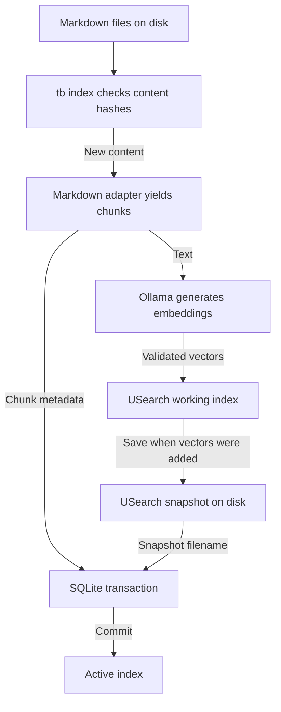

# Trombone

Trombone is a Rust CLI for building a local semantic index of Markdown notes. The `tb` binary splits notes into chunks, generates embeddings through Ollama, and stores chunk metadata in SQLite and vectors in USearch.

## Quick start

You need a current Rust toolchain, a C/C++ compiler for the native dependencies, and a running Ollama server. The [example config](trombone.toml) uses `embeddinggemma` with 768 dimensions.

```sh
ollama pull embeddinggemma
cargo build --locked
./target/debug/tb --config trombone.toml index /path/to/notes
```

To test indexing on a single note, pass its path to the same command.

```sh
./target/debug/tb --config trombone.toml index /path/to/note.md
```

In a terminal, indexing shows live counts, the current file and chunk, and the save and commit stages. When output is redirected, for example through `tee`, it streams plain-text progress lines. The final counts report committed changes.

Without `--config`, `tb` reads `~/.config/trombone/trombone.toml`. Set `[database].path` to an existing directory. Relative paths resolve against the directory containing the config file after following symlinks. Trombone stores `trombone.sqlite` and `trombone-index-*.usearch` inside that directory. Set `[ollama].model` and `expected_dimensions` together when choosing a model, and use a fresh database directory when changing the model or chunk size for an existing index.

## How indexing works



- A file whose content hash matches its saved version is skipped. Byte-identical files share chunk rows and vectors. SQLite stores source paths, byte and line ranges, heading paths, and the keys that identify vectors in USearch. The Markdown files hold the text.
- Each file gets a SQLite savepoint. If a chunk fails, Trombone rolls back the file's rows and removes any vectors it added for that file from the working index. By default it continues with the remaining files. With `--glass`, it stops at the first error and rolls back the run.
- After processing the input, Trombone checks stored paths in scope and removes entries for files that have disappeared. A directory includes its descendants. A single-file run checks only the selected path. Shared chunks survive while any document still references them.
- When the run adds vectors, Trombone saves one new USearch snapshot before committing SQLite. The commit publishes the snapshot filename and the updated chunk rows together. The final summary counts indexed and removed files after the commit.

The `tb search` command is currently a stub. Superseded vectors can remain after edits and deletions, and a cleanup command is planned.

## Development

```sh
cargo test --locked
cargo clippy --locked --all-targets -- -D warnings
```

Licensed under the [MIT License](LICENSE).
