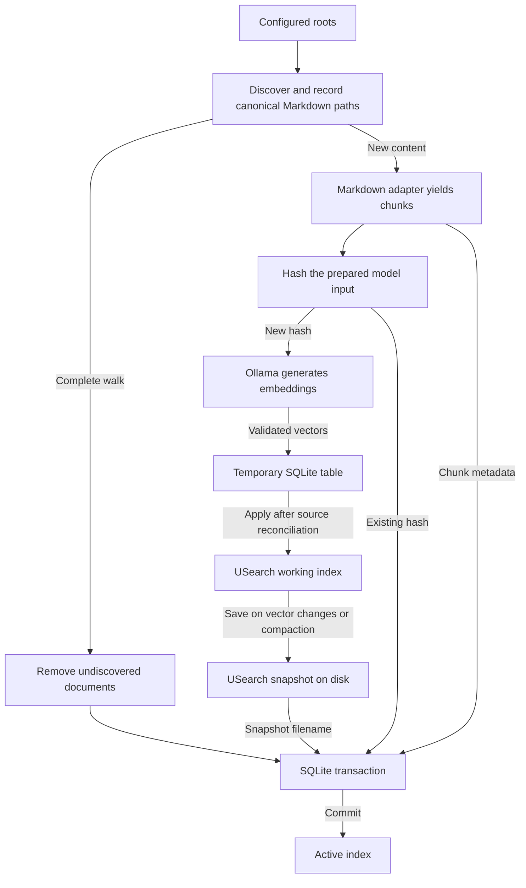

# Trombone

Trombone is a Rust CLI for building a local semantic index of Markdown notes. The `tb` binary splits notes into chunks, generates embeddings through Ollama, and stores chunk metadata in SQLite and vectors in USearch.

## Quick start

You need a current Rust toolchain, a C/C++ compiler for the native dependencies, and a running Ollama server. The [example config](trombone.toml) uses `embeddinggemma-2:740m-bf16` with 768 dimensions.

Set the top-level `roots` array in the TOML before running `tb index`. Put it before the first table header.

```toml
roots = ["./notes", "/path/to/other/notes"]
```

```sh
ollama pull embeddinggemma-2:740m-bf16
cargo build --locked
./target/debug/tb --config trombone.toml index
```

`--chunk-size` overrides `[chunking].size` for the pass. In a terminal, indexing shows live counts, the current file and chunk, and the save and commit stages. When output is redirected, for example through `tee`, it streams plain-text progress lines. The final counts report committed changes.

Only one `tb index` or `tb compact` can write to a given database at a time.
A command that encounters an occupied writer lock exits with a busy message.
`tb index` checks the Ollama model before attempting to acquire the lock.
Different databases can be written independently. Search can run against the
previously published index while a writer prepares changes.

The final summary explicitly states whether the pass was published, whether its vector snapshot changed, and whether automatic compaction ran. It includes indexed, reused, unchanged, and removed document counts, attempted file count, and error count. With a fatal error, committed counts are zero and any prepared work is reported separately. A pass with recoverable errors can publish its successful changes but still exits with a failure status.

Without `--config`, `tb` reads `~/.config/trombone/trombone.toml`. Set `[database].path` to an existing directory. Relative paths in `database.path` and `roots` resolve against the directory containing the real config file after following symlinks. Indexing requires at least one directory path and rejects empty paths before opening SQLite or initializing Ollama. Search and compaction can use an existing database without `roots`. Trombone stores `trombone.sqlite` and `trombone-index-*.usearch` inside that directory. Set `[ollama].model` and `expected_dimensions` together when choosing a model, and use a fresh database directory when changing the model or chunk size for an existing index.

Indexes built when Markdown headings were included in chunk text require a rebuild. Point `[database].path` at a fresh directory and run `tb index` on your notes.

Ollama calls allow 10 seconds to connect and 120 seconds for a complete request,
including response decoding. Override these positive integer limits with
`[ollama].connect_timeout_secs` and `request_timeout_secs`. The total deadline
also covers model metadata lookup. Increase the request timeout for models that
take longer to load or generate embeddings on your machine. An embedding timeout
is reported for the affected file, and the indexing pass continues.

Set the optional `[ollama]` templates to customize the text sent to the embedding model. For EmbeddingGemma:

```toml
chunk_format = "title: {title} | text: {text}"
query_format = "task: search result | query: {query}"
```

The chunk template requires `{text}` and can use `{title}` for the heading path (or `none` if there is no heading). The query template requires `{query}`. Use `{{` and `}}` for literal braces. Omit the templates to use the heading path followed by the chunk body, and the raw search query.

Changing `chunk_format` requires a fresh database directory and a new indexing run. Changing only `query_format` takes effect on the next search.

At the start of indexing or search, Trombone reads the selected model's digest from [Ollama's model list](https://docs.ollama.com/api/tags). The digest is stored with the active snapshot and must match on subsequent commands, even when the model name and dimensions are unchanged. A mismatch stops the command before generating embeddings; restore the indexed model or rebuild in a fresh database directory. Missing models or unavailable digest metadata are errors. The lookup runs once per command, and `compact` preserves the stored digest without contacting Ollama.

## How indexing works

The configured `roots` describe the entire desired document set for `database.path`. Each complete pass reconciles the whole database. Configs that share a database but list different roots can therefore remove one another’s documents.



- A file whose content hash matches its saved version is skipped. Byte-identical files share chunk rows and vectors. SQLite stores source paths, byte and line ranges, heading paths, and the keys that identify vectors in USearch. The Markdown files hold the text.
- The walker follows file and directory symlinks, including targets outside the configured roots. It skips recognized cycles and hidden descendant directories by their name on the traversal route. An explicitly configured hidden root is traversed. The canonical file must have the `.md` extension. The index stores and search reports that canonical absolute path. Overlapping roots and multiple routes to the same file share one processing attempt.
- Chunk size compatibility is checked once before loading the vector snapshot or scanning files. A mismatch aborts the pass with one diagnostic, including for an empty input directory, and leaves existing data unchanged.
- Markdown headings mark section boundaries. Each chunk spans body text. The configured template controls the input sent to Ollama. Search displays the heading path separately from the original excerpt and its line range.
- Chunks with identical prepared Ollama input share one vector, even across different files. SQLite stores the full 32-byte BLAKE3 hash and the 64-bit USearch key. The key starts with the first eight hash bytes in little-endian order. If already assigned to a different hash, Trombone probes consecutive keys and skips USearch's reserved key. Existing assignments stay stable while referenced.
- The walker records each discovered canonical Markdown path in a temporary SQLite set before reading it, outside the file savepoint. Read, processing, and embedding errors preserve any previous record and allow work on other files to continue. A processing or embedding error rolls back that file’s rows and new vectors. Storage or savepoint failures abort the transaction.
- After a complete walk, Trombone removes any document that was undiscovered across all configured roots. Removing a root or symlink drops a document when its last route disappears. An accessible empty directory counts as complete. Shared chunks survive while any document still references them.
- An unavailable or invalid root, a dangling symlink, or an error enumerating or resolving sources makes the walk incomplete. The summary reports that global deletion was deferred. Successful updates from roots that opened can still publish. If no root opened, the pass ends without publication. Any reported error produces a nonzero exit status.
- Before committing, Trombone checks keys whose chunk references were removed during the pass. It discards their staged vectors or removes them from the graph, and deletes their SQLite hashes, only if no current chunk references the key. This lets an edited note relink an unchanged chunk before cleanup.
- When the run adds or removes vectors or compaction is due, Trombone prepares and saves one USearch snapshot before committing SQLite. The commit publishes the snapshot filename and the updated chunk rows together. A pass with no vector changes or compaction reuses the existing snapshot without loading its graph. A failure while applying or publishing vector changes rolls back the pass. The final summary counts indexed and removed files after the commit.

## Search indexed notes

```sh
./target/debug/tb --config trombone.toml search "how are embeddings stored?" --limit 5
```

Search prints the Markdown excerpt, its path and line range, the heading path when available, and its cosine distance. The default limit is five results. Search starts with as many vector candidates as requested results. If there are too few valid excerpts, it doubles the candidate count until it fills the request or reaches four times the limit or the index size. It can return fewer results. Each candidate source path is read and hashed at most once per query, and its hash is checked against the indexed content hash before taking an excerpt. All excerpts from the same path use that first observed version, even if the file changes during the query. Failed reads are also cached. Every new query starts with an empty cache. Reindex edited files to make them searchable again.

Search returns at most one excerpt per vector and tries other occurrences if the first is stale or unreadable.
Each search round collects vector candidates and all their alternative source
paths from one consistent SQLite/vector snapshot, then releases the mapping
and transaction before reading Markdown. A retry can see a newer publication.
The output uses the final round’s ranking, and the same source cache is shared
across rounds.

Use `--output=json` to get an array of results in search order. Each result has `path`, `line_start`, `line_end`, `section_path`, `cosine_distance`, and `text`. Line numbers are one-based and inclusive, and `section_path` is an array of headings or `null`. An empty result is `[]`.

## Compact the vector index

```sh
./target/debug/tb --config trombone.toml compact
```

Compaction builds a fresh USearch graph containing only vector keys referenced by current SQLite chunks. It rebuilds the graph after deletions and preserves existing embeddings, keys, and model settings. It does not read source files or contact Ollama, and it uses the stored index settings rather than the current embedding model configuration.

The command reports vector counts before and after compaction. A fresh graph can change approximate search ordering even though the embeddings stay the same. Compaction does not reindex edited files or remove missing document paths; run `tb index` to reconcile those changes first.

Compaction holds the writer lock and publishes its snapshot through the same save, sync, and SQLite commit sequence as indexing. If rebuilding or publication fails, the previous snapshot stays active. The old snapshot is removed after a successful commit. With no active index, the command reports that there is nothing to compact.

Indexing automatically compacts before saving its snapshot when both conditions hold:

- At least 100 vector removals have accumulated since the last successful compaction.
- `removals / (live vectors + removals)` is at least 25%. Live vectors are counted by distinct vector key, including when several chunks share one.

If no live vectors remain and there have been removals, indexing immediately rebuilds an empty index. Compaction reuses existing embeddings and saves only the final rebuilt snapshot. The number of scanned files does not affect the threshold.

To defer automatic compaction for one indexing pass:

```sh
./target/debug/tb --config trombone.toml index --no-compact
```

The accumulated removal count is stored with the active snapshot in SQLite. It counts removals from the USearch graph. Vectors discarded from SQLite staging never enter the graph. Deferral preserves the count; a later pass can compact even without new removals. Successful manual or automatic compaction resets it to zero. A failed publication leaves the previous snapshot and count unchanged.

Database schema and vector format versions must exactly match the versions supported by the binary. The current database schema is version 6, and the logical vector format is version 2 (hash-derived keys). There are no migrations or compatibility fallbacks during development. When either version differs, the command exits with an error; use a fresh database directory and reindex the notes.

## Development

Embedding generation is isolated in `src/embeddings.rs`. Indexing and search use the synchronous `Embedder` interface for chunk embeddings, query embeddings, and embedding settings. `OllamaEmbedder` owns model-specific input formatting, the Ollama client, one reusable Tokio runtime, and response validation. Compaction does not construct an embedder. Document opening and Markdown chunking remain outside this component.

`indexer` owns the file-processing sequence: unchanged-file decisions, content
reuse, lazy adapter opening, chunk iteration, vector-key allocation, and vector
staging. Its file savepoint covers the document and chunk metadata as well as
new vectors. `database` supplies storage queries and writes, including cached
chunk and vector inserts, without adapter or embedding callbacks.
`IndexStatus` belongs to the indexing report types. Persistence orchestration
regressions live in `src/indexer/tests.rs` and its submodules.

Every chunk carries a typed `SourceLocation` with zero-based, half-open byte offsets and one-based, inclusive line numbers. SQLite stores these coordinates in dedicated integer columns and reconstructs the same type when resolving search candidates. JSON attributes hold additional metadata. Search JSON keeps its existing `line_start` and `line_end` fields.

`indexer::run` returns an `IndexReport` for every attempt, including aborted attempts. The report separates staged and committed `IndexCounts`, records files attempted and diagnostics with optional source paths, and exposes a `PublicationStatus`. Published status includes snapshot-update and compaction flags. `is_success()` requires publication without indexing errors. Indexing owns these statistics and emits structured progress events, including current counters. Snapshot publication emits save and commit events and reports cleanup failures as warnings. The CLI passes a callback to `Reporter`, which formats progress, warnings, and the final report. Other callers can capture events or ignore them.

```sh
cargo test --locked
cargo clippy --locked --all-targets -- -D warnings
```

Licensed under the [MIT License](LICENSE).
